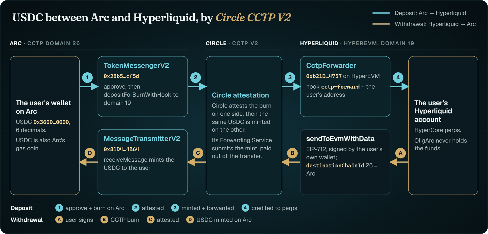

  

  
  
  
  

## What OligArc is

A non-custodial, mobile-first trading app on Hyperliquid perps: crypto, stocks, commodities and indices.
Open any market and see every trader and whale in it, live: size, side, entry, liquidation and PnL. Trade from the same screen.
Your wallet stays yours: OligArc never holds funds, and the trading key it sets up can only sign orders, never withdraw.
**Points Season 1 is live.**

  
   Demo mode, simulated data.

## Built on Arc with Circle

Money in OligArc is USDC, and it moves between Arc and the user's own Hyperliquid account over **Circle CCTP V2**.
A deposit from Arc is two wallet transactions; a withdrawal is one signature, and it lands on Arc in about 10 seconds.
How it works, with the code: [arc-hyperliquid-cctp](https://github.com/oligarcxyz/arc-hyperliquid-cctp).

<picture>
  <source media="(prefers-color-scheme: dark)" srcset="assets/cctp-flow-dark.png">
  <source media="(prefers-color-scheme: light)" srcset="assets/cctp-flow-light.png">
  
</picture>

## $OLIG

- **Contract:** [`0x14385d2f530Ba1763eDe4fB3E5471275305b739f`](https://explorer.arc.io/address/0x14385d2f530Ba1763eDe4fB3E5471275305b739f) on Arc (chain id 5042)
- **Verified:** [Sourcify](https://repo.sourcify.dev/5042/0x14385d2f530Ba1763eDe4fB3E5471275305b739f) · [Etherscan](https://arc.etherscan.io/address/0x14385d2f530Ba1763eDe4fB3E5471275305b739f#code) · [Blockscout](https://explorer.arc.io/address/0x14385d2f530Ba1763eDe4fB3E5471275305b739f?tab=contract)
- **Supply:** 1,000,000,000 OLIG, fixed. No mint, pause, blacklist or tax; `owner()` is `0x0`.
- **Trading:** none until TGE, planned for Q2–Q3 2027, with no guarantee of date.

Planned allocation: 40% Points airdrop · 40% staking rewards & community reserve · 5% launch liquidity · 5% treasury & ecosystem ·
5% future seasons · 5% team. Details and conditions on the [roadmap](https://oligarc.xyz/roadmap).

## Repositories

- **[olig-token](https://github.com/oligarcxyz/olig-token)**: the $OLIG contract, byte-for-byte as verified, with its tests and how to check it against the chain.
- **[arc-hyperliquid-cctp](https://github.com/oligarcxyz/arc-hyperliquid-cctp)**: move USDC between Arc and Hyperliquid with Circle CCTP V2, reference code from the production app.

## Contact

[oligarchelp@gmail.com](mailto:oligarchelp@gmail.com) · [X @oligarcxyz](https://x.com/oligarcxyz) · [oligarc.xyz](https://oligarc.xyz)

Perpetual futures are risky and you can lose your margin. Nothing here is financial advice.
